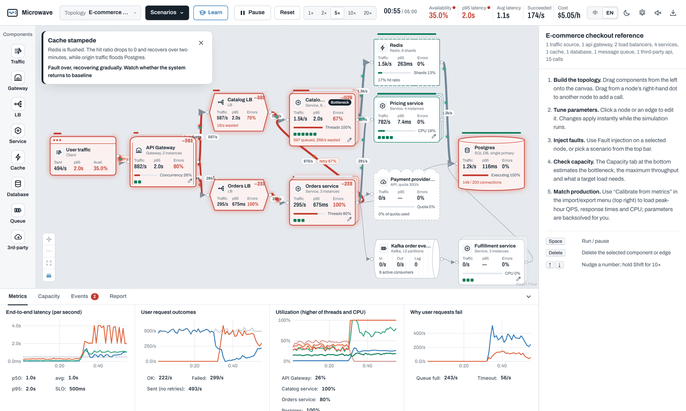
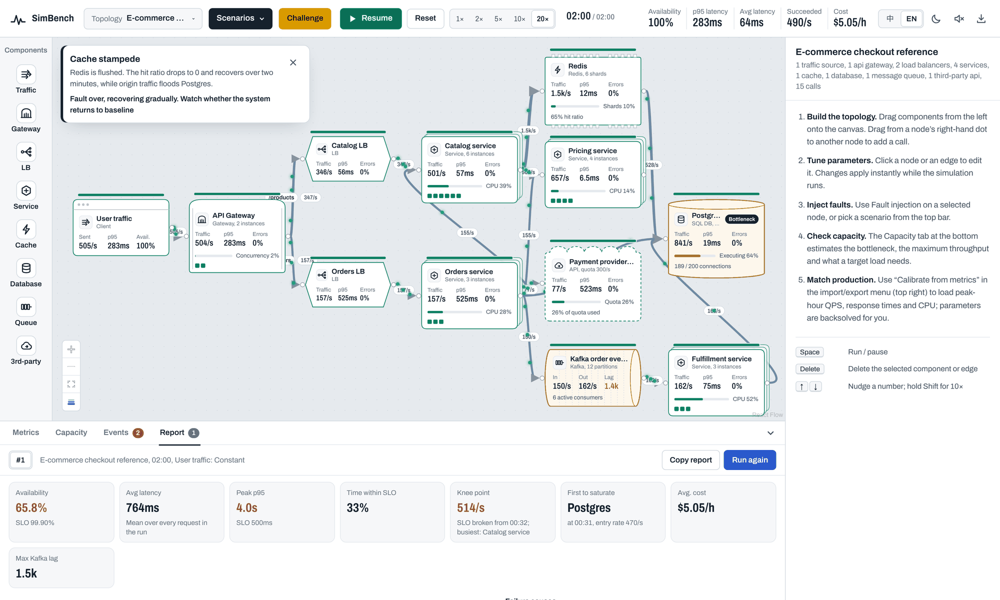

# Microwave: a microservice performance simulation workbench

> Formerly SimBench. The repository is still named `perf_sim_workbench`.

Build a microservice topology by drag and drop, tune capacity, timeouts, retries and circuit breakers, inject faults, and watch bottlenecks, SLO impact and cascading failures in real time. An analytical model alongside the simulation gives steady-state capacity estimates.



*The Cache stampede scenario: Redis is flushed, misses flood Postgres, and failures climb upstream. Red cards are failing components; edge width shows traffic volume.*



*A timed run ends with a report: availability, average and p95 latency, time within SLO, the knee point (the entry rate where the SLO starts breaking) and the first component to saturate.*

The UI is in English by default and can be switched to Chinese (中文); light and dark modes are both available (top right). The choice is saved in the browser. On first load it follows the browser language and the system theme.

中文说明见 [README.zh-CN.md](README.zh-CN.md).

## Traffic models and run reports

Select any traffic source and pick how traffic arrives in the **Traffic model** panel on the right, by picture or by name:

- Base models: constant, linear ramp (up or down), step, sine wave, diurnal, and replay (paste `seconds,rps` data)
- Overlays: spike, periodic burst, thundering herd after an outage, and random noise. Overlays stack; spike and herd can be fired on demand with **Fire now**

Everything can be changed while the simulation runs; the curve preview covers exactly the current run (0:00 to the chosen duration, like the run clock in the top bar), and a red line marks the current time; when a run finishes the line sits at the right end. Each traffic source has its own model, and their traffic adds up wherever they share components (see the **Multiple traffic sources** preset).

**Request path mix.** A traffic source's requests are split across URL paths, one row each: the path (for example `/orders`) and its share in percent. **Add path** adds a row prefilled with whatever is left to reach 100%, and the × at a row's end removes it. The total turns red with what's short or over, and **Run** stays blocked until the shares add up to exactly 100%; trying to run selects the source so the editor is in view. An API Gateway routes each request by path prefix. Topologies saved with the older relative weights (`/:1`, `/orders:0.3`) open as percentages; the traffic they send is the same.

**Fault injection.** Select a component and open **Fault injection** in the inspector: a service can slow down, crash instances or spike errors; a database can get slow queries, lock contention or a failover; a cache can be flushed; and so on. Each fault has its settings (for example the multiplier), how long it **Lasts** (0 keeps it on until you press **End**), and for some a recovery time. Under the settings, a small curve shows the fault's level over time, and **Estimated impact** shows what it does to this component and to the two components it hurts most: utilization and latency before → during, red when overloaded. The estimate is the steady state from the capacity formulas, so it is instant but leaves out retries, timeouts and how the failure spreads over time; the run shows those. Injecting while the simulation runs takes effect at once. Once injected, the same curve shows progress: the part already past is shaded darker, a dashed line and dot mark the current moment with the time elapsed, and the countdown below shows what is left; faults with a recovery time (such as a cache flush) stay on the curve until they have fully recovered, and a fault with no end shows how long it has been on.

Click the clock in the top bar to pick a run length (1, 2, 5, 10 or 30 minutes of simulated time). The run stops on its own, and the **Report** tab shows availability, average latency, latency at the SLO percentile over the whole run (plus the worst single second), time within SLO, the knee (the incoming rate at which the SLO keeps breaking), the first component to saturate, peak utilization per component, failure causes and cost. Reports can be copied as Markdown.

**Comparing runs.** Each report is compared with the previous run of the same topology by default; **Compare with** picks any other run of that topology (the last 10 runs are kept). A **What changed** box lists every configuration difference between the two runs: components and calls added or removed, and each parameter or traffic model that changed, with the old value struck through and the new one highlighted. If parameters were edited while a run was going, the report says so (a note at the top of the report, and in the comparison), since its results mix both settings.

**Exporting.** **Export** in the report bar downloads three kinds of file: this run alone as Markdown (no comparison), this run's raw data as JSON (every metric, per-component statistics and the full configuration it ran with), and a comparison report as Markdown (both runs side by side, what changed, and better/worse for each metric).

**Editing on the card.** While the simulation isn't running (before the first run, or paused), double-click a component's name to rename it (Enter saves, Esc cancels), and hover a card for a −/+ stepper on the parameter changed most often: rate for a traffic source with a constant model (Shift steps by 100), instances for services and gateways, read replicas for databases, consumers for queues, hit ratio (or shards) for caches, and quota for third-party APIs. The × at the card's top-right corner deletes the component along with its connections; the toast that follows has **Undo**, which also works after deleting with the Delete key or the inspector's trash icon. Everything else, and any change during a run, goes through the inspector on the right. Components a challenge level locks can't be edited on the card either.

**Latency SLO percentile.** The latency SLO is set on the traffic source and measured at **p95** by default; switch it to **p99** under the traffic source's SLO settings. The top bar, node cards, charts, SLO check and run reports all follow that choice. Average latency is shown alongside it in the top bar, the inspector, the latency charts and the run report. Challenge mode always uses p99, so level scores stay comparable.

**Cost.** The cost in the top bar and in run reports is estimated from rough unit prices (for example $0.10 per service core-hour, $0.12 per cache shard-hour, $0.40 per database instance-hour). Use it to compare designs, such as more instances versus a cache. It is not a forecast of a real cloud bill: the unit prices are not tied to any provider's price list, and storage, data transfer, usage-based charges and discounts are not modeled.

## The e-commerce reference

The default preset, **E-commerce checkout reference**, is a small online shop with 4 services, 1 third-party API and 15 calls:

| Component | Role | Calls |
|---|---|---|
| API Gateway | Routes `/products` (70%) and `/orders` (30%) | Catalog LB, Orders LB |
| Catalog service | Product pages | Redis ×3 and Pricing, in parallel |
| Orders service | Orders | Catalog and Pricing in parallel → Payment provider (half of requests, the ones that place an order) → Postgres → Kafka |
| Pricing service | Current price of a product or a cart; a hard dependency on both paths | none: price rules sit in an in-process cache |
| Payment provider API | Third-party payment | none |
| Fulfillment service | Consumes order events from Kafka | Postgres |
| Redis, Postgres, Kafka | Cache, database, order event stream | Redis falls back to Postgres on a miss |

Challenge levels use the same shop without Pricing and the payment provider, so their balance stays as designed.

## Traffic splitting and the cache model

- **Exclusive routing.** Traffic sources and load balancers can have several outgoing edges; each request takes exactly one, chosen by **weight**. Gateway routes with the same prefix are split by weight too. On services and caches, outgoing edges marked **Exclusive choice** within the same call order are reduced to one call per request. Edges show their share (for example 90% / 10%), which covers canaries, A/B tests and multi-region setups. Unmarked edges are still called every time (plain dependencies). See the **Canary release** preset.
- **Edge width follows traffic.** Each edge's width scales with its calls/s relative to the busiest edge seen in the current run (that share raised to 0.65, so the busiest edge is 10 px and one with a tenth of its traffic is about 3 px; quiet edges never vanish), smoothed over about 3 seconds. Particles show only that traffic is moving and how it fares (ok, failed, retried); the exact rate stays on the edge label.
- **Cache hit ratio.** Set it directly, or let it **follow capacity**: the steady-state LRU hit ratio is computed with Che's approximation from shards × keys per shard, total key space and access skew (Zipf). After a flush or a cold start the cache starts at 0 and every successful origin fetch puts one key back, so the hit ratio warms up over time; if origin fetches slow the database down, warm-up slows down too. See the **Cache warm-up** scenario.

## Third-party APIs

The **Third-party API** component (dashed cloud in the palette) stands for a service you don't run: a payment provider, SMS, maps, an LLM. Modeling one as a regular service would be misleading, because you can't add instances or CPU to someone else's system. What you live with instead:

- **Response time and error rate**, as seen from your side. Its internals are a black box.
- **Quota**: requests per second (a token bucket with a burst allowance) and optionally a cap on calls in flight. Calls over either get **429**, which shows up as "Provider quota (429)" in failure causes.
- **Cost per 1,000 calls**, added to the running cost. Calls rejected with 429 are not billed.
- **Faults**: provider slowdown, outage, error spike, and quota cut (throttled to a share of the quota).

The **E-commerce checkout reference** preset includes one: the Orders service calls a **Payment provider API** after checking stock, for the half of `/orders` requests that place an order. (Challenge levels use the reference without it, so their balance is unchanged.)

It is a leaf: it has no outgoing calls. The defenses live on the edge that calls it: timeout, retries, retry budget, circuit breaker and fallback. Its utilization is the share of quota in use, and the Capacity tab plans quota rather than instances. In calibration, its `avg_ms` becomes its response time directly.

The **Checkout with a payment provider** preset and the **Payment provider slowdown** scenario show the classic failure: the provider gets 6× slower, Checkout threads sit waiting on it, and even requests that never pay start failing. A 1 s timeout, no retries and a circuit breaker with a fallback contain it: during the fault, availability stays near 99% and p99 near 1 s, against 94% and 4 s without them.

## Calibrating against production

Out of the box every service time is a guess. Calibration replaces the guesses with values backsolved from a few metrics you already have, so the simulated "today" matches your production baseline and what-if runs start from something credible.

1. Build (or load) the topology so its component names match your services.
2. Open the import/export menu (top right) → **Calibrate from metrics (CSV)…**. **Fill template from canvas** gives you a CSV with every component's name to start from.
3. Fill in metrics from a typical peak hour, all from the same 5–15 minute window. Blank cells keep the template value.
4. **Preview calibration** shows every parameter that would change and flags inputs that can't all be true. **Apply and verify** applies the values and runs 60 simulated seconds at the measured load, then shows measured vs simulated values with the error for each. **Undo calibration** puts the previous topology back.

| Column | Meaning |
|---|---|
| `name` | Component name on the canvas (case-insensitive) |
| `type` | Optional check: client, gateway, lb, service, cache, database, queue, external |
| `qps` | Requests per second arriving at the component |
| `avg_ms` | Server-side mean response time, including its downstream calls (for a cache: the command itself) |
| `p99_ms` | Optional; sets the tail shape of the processing time |
| `cpu_util` | CPU utilization against the CPU limit: `0.38`, `38` or `38%` |
| `pods`, `cores_per_pod`, `threads_per_pod` | Instances, CPU limit per pod, thread pool size |
| `db_pool_per_pod` | Connection pool size per pod, applied to the component's database calls |
| `max_connections`, `hit_ratio` | Database connection limit; cache hit ratio |

```csv
name,type,qps,avg_ms,p99_ms,cpu_util,pods,cores_per_pod,threads_per_pod,db_pool_per_pod,max_connections,hit_ratio
Catalog service,service,625,32.3,,42.5%,8,2,,,,
Orders service,service,188,168,,13.9%,4,2,,20,,
Postgres,database,488,9.3,,,,,,,200,
```

A complete example for the **E-commerce checkout reference** preset is in `examples/calibration-reference.csv`.

How the backsolve works:

- **Structural values are copied in:** pods, cores, threads, pool sizes, connection limits, hit ratios and the entry rate. If a traffic source has no row, its rate is taken from the measured QPS of what it calls.
- **Service times are fitted iteratively** against the analytical model. The model predicts each component's mean response time (own time + queueing + downstream calls), and own time is adjusted until the prediction matches `avg_ms`. Databases and caches settle first, then their callers, so the call graph is solved bottom-up.
- **CPU share of a service's own time comes from the utilization law:** CPU time per request = CPU% × pods × cores ÷ QPS. **CPU overhead** in the dialog removes CPU that isn't caused by requests (GC, sidecars, logging, cron).
- **Sanity checks** flag routed traffic that differs from the measured QPS by more than 15%, CPU that can't fit inside the request, response times shorter than the downstream calls, thread pools or database connections near their limit, and baselines already above 85% utilization (where extrapolation is less reliable).

Limits: a service with several endpoints gets one blended processing time, so the baseline matches but a change in endpoint mix may not. One time window cannot pin down a database's non-linear contention (USL α, β); those keep their template values.

`npx tsx scripts/check-calibration.ts` runs a round trip: it hides changed parameters in a "production" copy of the reference topology, measures it by simulation, calibrates the untouched template, and checks that the simulator reproduces the measurements and that the hidden values come back.

## Comparing with real metrics (preview)

> **Preview.** This feature is usable now so you can try it and wire it to your stack, and it is marked *Preview* in the app. It will be standardized and extended later; the settings format and the `/obs` interface may change.

Fetch real numbers from your monitoring stack and see them next to the simulation's: traffic, average and P90 latency and CPU for services and gateways; commands per second, average command time and hit ratio for caches; queries per second, average query time, open connections and max connections for databases. Three kinds of source are supported:

- **Grafana MCP**: calls the `query_prometheus` tool of the Grafana MCP server ([mcp-grafana](https://github.com/grafana/mcp-grafana)) over streamable HTTP.
- **Grafana**: queries through Grafana's datasource proxy.
- **Prometheus**: queries Prometheus directly.

**1. Server side.** Copy `.env.example` to `.env.local` (git-ignored; the older `SIMBENCH_` prefix also works) and set the address, plus a token where needed, for each kind you use. Then run with `npm run dev` or `npm run preview`: the browser only calls `/obs/...`, and the dev/preview server forwards those requests and adds the token, so tokens never reach the browser. The single-file build opened from disk has no server, so this feature needs dev or preview. To run the Grafana MCP server in HTTP mode, for example: `docker run --rm -p 8000:8000 -e GRAFANA_URL=... -e GRAFANA_SERVICE_ACCOUNT_TOKEN=... mcp/grafana -t streamable-http` (older versions name the token `GRAFANA_API_KEY`) and set `MICROWAVE_MCP_URL=http://localhost:8000/mcp`. A read-only service account with `datasources:query` is enough.

**2. Settings.** Open **Settings** (the gear in the top bar) and add one or more **performance-data sources**. Each has a type, a Prometheus datasource UID (Grafana and MCP), a window (1, 5 or 15 minutes) and a set of PromQL templates for each kind of component. `{service}` and `{window}` are filled in at query time. Presets:

| Component | Presets |
|---|---|
| Services / gateways | OpenTelemetry (`http_server_request_duration_seconds`), Spring Boot / Micrometer (`http_server_requests_seconds`) |
| Caches | Redis ([redis_exporter](https://github.com/oliver006/redis_exporter)) |
| Databases | PostgreSQL ([postgres_exporter](https://github.com/prometheus-community/postgres_exporter) with the `stat_statements` collector), MySQL ([mysqld_exporter](https://github.com/prometheus/mysqld_exporter) with `perf_schema.eventsstatements`) |

Cache and database presets select the exporter by its Prometheus `job` label. Edit any template to match your metric and label names. **Test connection** runs `vector(1)`.

**3. Per component.** In the inspector's **Real metrics** section, pick a source and the label: the service label for a service or gateway (for example `order-service`), the Prometheus job for a cache or database (for example `redis-cart`); the pipette on the card does the same. A component whose name already looks like a label uses it automatically. **Fetch real metrics** fills a table of real vs simulated values with the difference. Simulated numbers are over the last 5 seconds; a note appears when the two traffic levels differ by more than 20%, since latency and CPU aren't comparable then.

**From the card.** The pipette at the bottom right of a service, gateway, cache or database card opens the same setup in place: pick the source, the label and which of that component's metrics to fetch, press **Fetch**, and the comparison appears right there. It works while the simulation runs, since reading real metrics changes nothing in the model; a green dot on the pipette means the component has fetched data.

**From real metrics to the model.** Under the comparison, **Set traffic to …** scales the traffic source so this component gets its real request rate (computed with the capacity analysis, so no run is needed), and **Calibrate from real metrics…** opens the calibration preview with a CSV built from every component fetched so far: measured traffic, average latency and CPU for services, hit ratio and command time for caches, query time and max connections for databases, plus pods, cores and threads from the canvas, and a traffic-source rate scaled from the measured component nearest the entry. Both change the model, so they're available while the simulation isn't running.

**One click for everything.** Once a source exists, **Fetch real metrics** in the top bar fetches every service, gateway, cache and database that has a label, and reports how many succeeded.

**What the simulated side means.** A cache's command time counts the command only (queueing plus execution), not the origin fetch on a miss, which is how Redis reports it. A database's connection count is open connections, idle ones held in client pools included, so the presets compare it with all connections, not only active ones. Message queues and external APIs don't have a pipette yet.

## Finding the limit

The **Capacity** tab answers "how much traffic can this system take?" by simulation as well as by formula. Under **Find the limit by simulation**, pick a criterion and press **Find the limit**:

- **Utilization cap** (default, ≤ 70%): the busiest component (CPU, thread pool, DB connections, cache shards, third-party quota) must stay under the cap. The 70% default leaves room for bursts and for losing an instance.
- **Hold the SLO**: availability and latency must stay within the client's SLO.

How it runs:

- **Stepping:** it resets the run and scales every traffic source together, starting from today's traffic. Each step settles for 15 s and is then measured for 15 s of simulated time. Load grows 1.25× per step while passing and drops when a step fails.
- **Narrowing down:** the utilization criterion interpolates between the last passing step and the first failing one. The SLO criterion bisects to within 5%.
- **Queue backlog counts as a failure.** If a queue's lag keeps growing during a step, its consumers can't keep up, so that load is not sustainable however low the CPU is.
- **Hold, then stop.** The estimated limit is held for the chosen time (default 1 min). If the hold fails, it backs off a little and tries again, up to 3 times. Then the run stops by itself.

The result card shows the limit (requests/s and multiple of today's traffic), **what limited it** and the busiest components at that load. **Details and export** shows every step and exports the result as Markdown. The last five results are kept for the session.

On the e-commerce reference, the limit is about 1.11× today's traffic. The constraint is not CPU: the Kafka order-events consumers (6, on 12 partitions) fall behind at the next step.

## Learning mode

**Learn** in the top bar opens one place with two tabs: **Lessons**, a guided course with one idea per lesson learned by doing in the real workbench, and **Challenges**, the levels below. Lessons teach; challenges check you can do it without hints. First-time visitors are offered lesson 1 when the app opens.

- **Lesson 1, Meet the workbench (about 10 min):** build a traffic source → service system, set the run length (5 minutes: a run stops on time and writes a report) and the simulation speed (5×: how many simulated seconds pass per real second, without changing the results), run it, pause it to read throughput, availability, average and p95 latency and CPU, scale in from 3 instances to 1, and inject a slowdown; then end the run from the clock and read its report: whole-run results versus the top bar's last 5 seconds, the note that parameters changed mid-run (change one thing per run), failure causes, comparing runs and exporting.
- **Lesson 2, Queueing and utilization (about 8 min):** start from one instance at 100 req/s, turn the traffic up level by level (130, 160, 180, 200, 220) while a chart of average latency against traffic builds from your own measurements, see it stay flat and then shoot up past about 85% CPU, explain it with the utilization law and 1 ÷ (1 − utilization), fix it with a second instance, and compare with the Capacity view.
- **Lesson 3, Scaling up and scaling out (about 9 min):** an overloaded 1-instance, 2-core service at 340 req/s gets 4 cores two ways: one instance with 4 cores, then two instances with 2 cores. The bigger instance has the lower p95 (one shared queue, the efficiency of pooling). Then at 250 req/s one instance crashes: the single big instance drops to 0% availability, while 4 instances with 1 core each dip to about 87% until health checks take the dead one out (N+1). Last, at 50 req/s, going from 1 to 4 cores per instance barely changes average latency: cores add throughput, not speed. Bar charts compare the setups with the learner's own numbers.
- **Lesson 4, Databases and connection pools (about 10 min):** a 3-instance service in front of Postgres at 300 req/s, with a pool of 2 connections per instance. Service CPU is under 40% while its threads are 100% busy, availability drops to about 83% and p95 to about 2 s: every thread is waiting for a connection. Little's law, using the query time the learner just measured, gives the pool size (about 2.4 connections in use per instance); a pool of 10 fixes it, and 100 is no faster. Then queries become 2× slower: with a pool of 100, queries pile up inside the database past the 500 ms timeout and availability falls to about 0%, while a pool of 10 keeps about 65–85% working. The wrap-up ties back to lesson 3: instances × pool size must fit what the database can take.
- Each lesson has steps that the app checks for itself (a node exists, a parameter has a value, the condition held for N seconds of simulated time), predictions answered before a run and revealed with the measured numbers, and explanations that quote the learner's own results.
- Starting a lesson saves the current workbench and sets the run length to 30 minutes; leaving restores both (also after a reload mid-lesson). At the end you can keep the lesson's topology and keep experimenting.
- Lessons live in `src/learn/lessons/` as data: starting topology, steps, checks, predictions and text in both languages. Lessons 5–8 (caching, retries, queues, capacity planning) are planned.

## Challenge mode

Open **Learn** in the top bar and pick the **Challenges** tab. Five levels, each harder than the last:

| Level | What it teaches |
|---|---|
| 1 First scale-out | Instance counts, CPU utilization, autoscaling cold starts |
| 2 Take load off the DB | Adding a cache yourself and rewiring calls |
| 3 Retry storm | Retry amplification, circuit breakers and fallbacks, dropping requests that queue too long |
| 4 Black Friday | Capacity planning across components, Kafka partitions and consumers, cost control |
| 5 Chaos monkey | Overall resilience under random faults (a different fault order each time) |

Rules: the error budget is your health bar. Failed requests drain it and the level is lost when it runs out; average cost must stay within budget. Score = reliability 500 + latency 300 + cost 200. Three stars = clear the level + p99 within SLO at least 90% of the time + average cost ≤ 80% of budget. Progress is saved in the browser.

Levels are defined in `src/game/levels.ts` (traffic curve, fault schedule, locked components and parameters, budget) and scoring in `src/game/rules.ts`; the browser and the headless tests share the same rules.

`npm run levels` plays every level twice, once doing nothing and once with a reasonable fix, to check the balance.

## Running

```bash
npm install
npm run dev        # local development, http://localhost:5173
npm run build      # produces dist/index.html (a single file you can open directly)
npm run sim        # runs every preset scenario headless and prints the time series (engine regression test)
npm run sim -- slowdb 200   # one scenario only, 200 simulated seconds
npm run levels     # level balance test
npx tsx scripts/check-traffic.ts         # traffic models and multi-source superposition
npx tsx scripts/check-routing-cache.ts   # split ratios and cache warm-up
npx tsx scripts/check-calibration.ts     # calibration round trip against a hidden "production"
```

## Layout

```
src/engine/          simulation core with no UI dependency (runs on its own in Node)
  types.ts           types for topology, parameters and metric snapshots
  specs.ts           parameter definitions for the 8 components and the call edge (defaults, ranges, help); forms are generated from it
  dist.ts            random numbers and distributions (lognormal is given as median + p99)
  sim.ts             request-level discrete-event simulator
  analysis.ts        analytical layer: forced flow law, M/G/c (Erlang C + Allen-Cunneen), USL, capacity plans
  presets.ts         preset topologies and demo scenarios
  host.ts            advances the simulation in real time, schedules faults, emits per-second metrics
  cost.ts            running cost model ($/hour), rough unit prices for comparing designs
  traffic.ts         traffic models: base model + overlays, evaluation and replay parsing
  cachemodel.ts      cache hit ratio: Zipf + Che's approximation (LRU)
  calibrate.ts       calibration: CSV parsing, backsolving parameters from production metrics, verification run
src/game/            levels and scoring (no UI dependency)
src/learn/           learning-mode lessons: topology, steps, checks, predictions
  worker.ts          Web Worker entry (falls back to the main thread when workers are unavailable)
src/ui/              React UI: React Flow canvas, inspector, uPlot charts, capacity analysis
  i18n.ts            language switch: components use t('中文', 'English'); engine text is {zh, en}
  theme.ts           light and dark chart palettes (checked for color blindness and contrast)
  NodeShape.tsx      a distinct outline per component (browser window, arch, router, replicas, memory stick, cylinder, pipe, dashed cloud)
  game.ts / GameUI.tsx  challenge mode: level select, briefing, HUD, countdown, results
  sound.ts           WebAudio synthesized sound effects (off by default)
  TrafficEditor.tsx  traffic model editor (model cards, curve preview)
  runs.ts / Report.tsx  timed runs and run reports
  CalibrateDialog.tsx   calibrate from production metrics: CSV input, preview, verification
examples/            sample calibration CSV
scripts/run-scenarios.ts   headless scenario runner
```

## Simulation model

| Component | Primitives | Key mechanics |
|---|---|---|
| Traffic source | Arrival process | Poisson arrivals; traffic programs (base model + overlays); client timeout and retries |
| API Gateway | Instance pool + token bucket + router | Longest-prefix path routing; rate limiting returns 429 |
| Load Balancer | Router + health checks | Round robin, random, least connections, P2C; a failed instance keeps getting traffic until it is taken out |
| Service | Instance pool (threads) + CPU cores + downstream calls | The I/O part is pure delay, the CPU part queues for a core; optionally holds a thread while calling downstream; GC pauses; drops requests that queue too long; HPA-style autoscaling (cold start, scale-down stabilization) |
| Cache | One thread per shard + hit/miss split | Hot shard; misses go to the origin (outgoing edge); cache-aside write-back; the cache timeout covers only the cache operation |
| Database | Parallel execution slots + connection limit + read/write split | USL: S × (1 + α(N−1) + βN(N−1)); queueing bounded by max connections; failover |
| Message queue | Partitioned buffer + consumer group | Effective parallelism = min(consumers, partitions); rebalance pauses; failed messages retried, then dead-lettered |
| Third-party API | Black-box delay + quota | Sampled response time and error rate; the provider's quota as a token bucket on rate plus an optional in-flight cap, both answered with 429; billed per call; no capacity of your own to scale |
| Call edge | Timeout, retries, circuit breaker, connection pool | Exponential backoff + full jitter; retry budget; three-state breaker; a pool per caller instance, counted against the database connection limit |

When a caller times out, the callee keeps working. The **wasted work** metric counts exactly that, and it is the root of retry storms and metastable failures.

**How latency percentiles are counted.** Every second the engine records a latency histogram (4% buckets, about ±2% error) for the whole system and for each component. Percentiles over any period come from merging those histograms, so they cover every request in the period:

- The top bar, the node cards and the inspector show the last 5 seconds.
- The report shows the whole run, with the worst single second in the tile's note.
- Lesson measurements and the limit search's hold use their own windows.
- Charts plot per-second values. With a few hundred requests a second, a single second's p95 rests on about ten requests, so it jumps around; that is why the windowed numbers are steadier than the chart.

## Known simplifications

- Every request to a service follows the same handler (no per-endpoint handlers); paths only matter for gateway routing
- Network latency is sampled independently; there is no bandwidth or packet-loss model
- A cache's origin calls hang off the cache node's outgoing edges, and connection pools are counted per original caller instance
- Parallel calls finish with the slowest one; the analytical layer estimates that wait as E[max] of exponential-like latencies, which is close but not exact for long-tailed calls
- The analytical layer ignores retries and faults; it is a steady-state reference, and the simulation is the source of truth for dynamics

## Adding a component

1. Declare its parameters and fault types in `NODE_SPECS` in `specs.ts`, with labels and help as `L('中文', 'English')` (the form appears automatically)
2. Add a handler in `deliver()` in `sim.ts`, built from `submit()` (instance pool), `callEdge()` (downstream calls) and `intensity()` (fault intensity)
3. For capacity estimates, add a branch to `latencyOf()` in `analysis.ts`
4. Add an icon in `Glyph.tsx` and list it in `PALETTE` in `App.tsx`

## Packaging as a desktop app

The engine does not depend on the DOM, so `dist/` can be wrapped directly with Tauri or Electron. For larger simulations, `src/engine` can be ported to Rust behind the same interface, using the output of `npm run sim` as the reference baseline.
