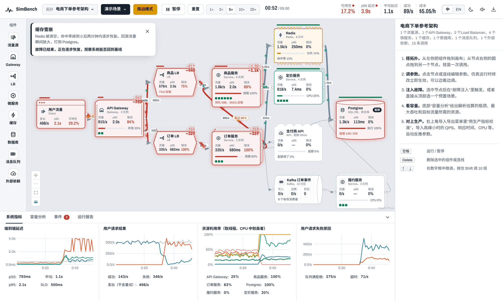
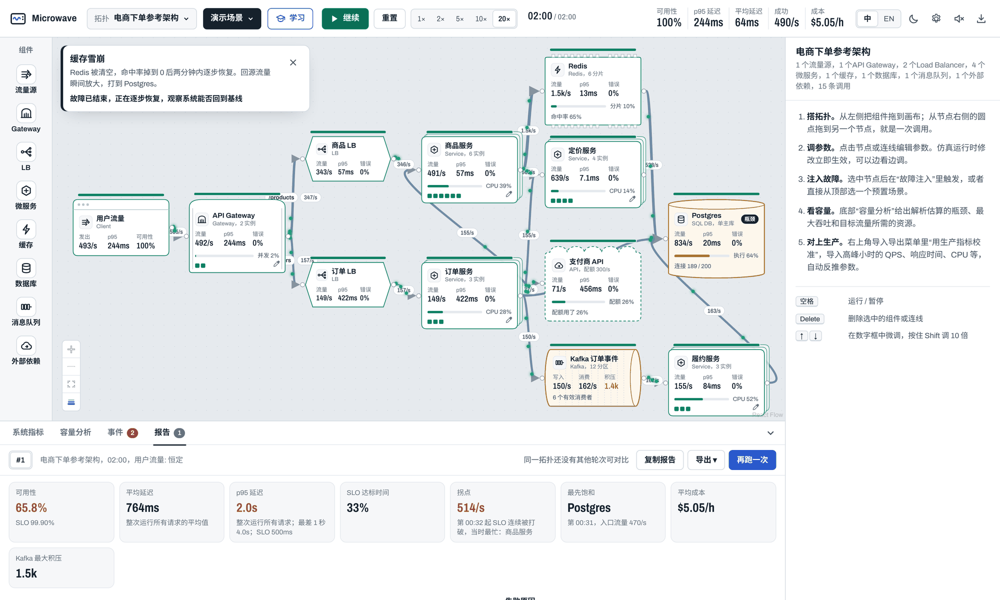

# SimBench：微服务性能仿真工作台

拖拽搭建微服务拓扑，调整容量、超时、重试、熔断等参数，注入故障，实时观察瓶颈、SLO 变化和级联故障。同时提供解析模型给出稳态容量估算。



*演示场景“缓存雪崩”：Redis 被清空，未命中的请求涌向 Postgres，故障一路向上游蔓延。红色卡片是出故障的组件，连线粗细代表流量大小。*



*定时运行结束后自动生成报告：可用性、平均延迟和 p95、SLO 达标时间、拐点（SLO 开始被打破时的入口流量）和最先饱和的组件。*

界面支持中文 / English 切换和浅色 / 深色模式（右上角），选择会记在浏览器里。首次打开时跟随浏览器语言和系统主题。

## 流量模型与运行报告

选中任意“流量源”，右侧“流量模型”里按图形或名称选择进入的流量：

- 基础模型：恒定、线性爬坡（也可回落）、阶梯、正弦波、日周期、真实回放（粘贴“秒,流量”数据）
- 叠加层：尖峰、周期突发、惊群回涌、随机抖动，可叠加多层；尖峰和惊群可以“现在触发”

运行中随时修改，曲线预览上的红线标出当前时刻。多个流量源各自有模型，按调用关系在共享组件处叠加（见预置拓扑“多流量源叠加”）。

点顶部时钟选择运行时长（1 / 2 / 5 / 10 / 30 分钟，仿真时间）。到点自动停止，底部的“报告”页给出可用性、平均延迟、SLO 分位数的延迟峰值、SLO 达标时间、拐点（SLO 连续被打破时的入口流量）、最先饱和的组件、各组件峰值利用率、失败原因和成本，可复制为 Markdown。

**对比不同轮次**：报告默认和同一拓扑的上一轮对比，也可以在“对比”下拉框里选同一拓扑的任意一轮（最多保留最近 10 轮）。“配置变化”框会列出两轮之间所有配置差异：新增或删除的组件和调用，以及每个改过的参数和流量模型，旧值划掉、新值高亮。如果某一轮在运行中改过参数，报告会注明，因为它的结果混合了改动前后两种配置。

**导出**：报告栏的“导出”可以下载三种文件：本次报告（Markdown，不含对比）、本次原始数据（JSON，包含所有指标、各组件统计和运行时的完整配置）、对比报告（Markdown，两轮并排、配置变化，以及每项指标是变好还是变差）。

**延迟 SLO 分位数**：延迟 SLO 设在流量源上，默认按 **p95** 衡量，可以在流量源的 SLO 设置里改成 **p99**。顶部指标、节点卡片、图表、SLO 判定和运行报告都跟着这个选择走。平均延迟和它一起显示在顶部指标、属性面板、延迟图表和运行报告里。挑战模式固定用 p99，关卡得分保持可比。

**成本**：顶部指标和运行报告里的成本按粗略单价估算，例如微服务每核每小时 $0.10、缓存每分片每小时 $0.12、数据库每个实例每小时 $0.40。它适合用来比较方案，比如“加实例”和“加缓存”哪个更划算，但不代表真实的云账单：单价没有对应任何云厂商的价格表，也没有计算存储、流量、按用量计费和折扣。

## 电商参考架构

默认的预置拓扑“电商下单参考架构”是一个小型网店：4 个微服务、1 个外部依赖、15 条调用。

| 组件 | 作用 | 调用 |
|---|---|---|
| API Gateway | 按路径分流：`/products` 70%，`/orders` 30% | 商品 LB、订单 LB |
| 商品服务 | 商品页 | 并行调用 Redis（3 次）和定价服务 |
| 订单服务 | 订单 | 并行调用商品服务和定价服务 → 支付商 API（只有下单的那一半请求）→ Postgres → Kafka |
| 定价服务 | 计算商品或购物车的当前价格，是两条路径上的硬依赖 | 无：价格规则放在进程内缓存里 |
| 支付商 API | 第三方支付 | 无 |
| 履约服务 | 消费 Kafka 里的订单事件 | Postgres |
| Redis、Postgres、Kafka | 缓存、数据库、订单事件流 | Redis 未命中时回源 Postgres |

挑战关卡用的是同一个网店去掉定价服务和支付商的版本，关卡平衡保持原样。

## 流量分配与缓存模型

- **互斥分流**：流量源、LB 可以连多条出边，按“分流权重”只选其中一条；Gateway 中前缀相同的路由同样按权重分；服务和缓存的出边勾选“互斥分流”后，同一调用顺序里勾选的出边每次只调一条。连线上直接标出比例（如 90% / 10%），适合金丝雀、A/B、多区域。未勾选的出边仍是“全部调用”（依赖调用）。见预置拓扑“金丝雀发布”。
- **线宽随流量变化**：每条连线的粗细按调用量（对数刻度）显示，以本次运行中流量最大的连线为参照，并做约 3 秒的平滑。粒子只表示流量在流动及其结果（成功、失败、重试），准确流量看连线上的标签。左下角缩放按钮下面的开关可以关闭这个效果。
- **缓存命中率**：可以直接指定，也可以“按容量推算”：由分片数 × 每分片 key 数、key 总数、访问倾斜度（Zipf）用 Che 近似算出 LRU 稳态命中率。缓存清空或冷启动后从 0 开始，每次成功回源装回一个 key，命中率随之回暖；数据库被回源压慢时，回暖也会被拖慢。见演示场景“缓存冷启动回暖”。

## 外部依赖（第三方 API）

“外部依赖”组件（组件栏里的虚线云形）代表不归你管的服务：支付商、短信、地图、LLM。把它当普通微服务建模会误导人，因为你没法给别人的系统加实例或 CPU。你能面对的只有：

- **响应时间和错误率**：从你这边看到的数字，对方内部是黑盒。
- **配额**：每秒请求数（带突发额度的令牌桶），可选限制同时在途的请求数。超出任一项返回 **429**，在失败原因里显示为“第三方配额 429”。
- **每千次调用费用**：计入运行成本，被 429 拒绝的调用不计费。
- **故障**：对方变慢、对方不可用、错误率飙升、配额下调（只剩原配额的一部分）。

“电商下单参考架构”预置拓扑里就有一个：订单服务在检查库存之后调用“支付商 API”，只有下单的那一半 `/orders` 请求会调用。（挑战关卡用的是不含支付商的版本，关卡平衡不受影响。）

它是叶子节点，不会调用别的组件。防护手段都在调用它的那条边上：超时、重试、重试预算、熔断和降级。它的利用率表示配额用了多少，容量分析给出的是需要多少配额而不是多少实例。校准时，它的 `avg_ms` 直接作为响应时间。

预置拓扑“结算与第三方支付”和演示场景“支付商变慢”演示了最典型的级联故障：支付商变慢 6 倍，结算服务的线程都在等它，连不需要付款的请求也开始失败。把超时改成 1 秒、不重试，再加上熔断和降级，就能把它挡住：故障期间可用性保持在 99% 左右、p99 约 1 秒，不加时是 94% 和 4 秒。

## 用生产指标校准

默认情况下，每个服务的处理时间都是估计值。校准会用你手上已有的几项指标反推出这些参数，让仿真里的“今天”对上生产基线，之后的假设推演才有可信的起点。

1. 搭好（或载入）拓扑，组件名和你们的服务名对应。
2. 打开右上角的导入导出菜单 →“用生产指标校准（CSV）…”。点“用当前画布生成模板”，可以得到一份包含所有组件名的 CSV 作为起点。
3. 填入一个典型高峰小时的指标，所有数据来自同一个 5 到 15 分钟的窗口。空着的格子保留模板里的值。
4. “预览校准结果”列出每个会改变的参数，并提示前后矛盾的输入。“应用并验证”会写入参数，在测得的负载下仿真 60 秒，逐项对比测量值和仿真值的误差。“撤销校准”恢复到校准之前的拓扑。

| 列 | 含义 |
|---|---|
| `name` | 画布上的组件名（不区分大小写） |
| `type` | 可选，用来核对：client、gateway、lb、service、cache、database、queue、external |
| `qps` | 到达这个组件的请求数/秒 |
| `avg_ms` | 服务端平均响应时间，含调用下游的时间（缓存填命令本身的耗时） |
| `p99_ms` | 可选，用来设定处理时间的长尾形状 |
| `cpu_util` | 相对于 CPU limit 的利用率：`0.38`、`38` 或 `38%` |
| `pods`、`cores_per_pod`、`threads_per_pod` | 实例数、每个 pod 的 CPU limit、线程池大小 |
| `db_pool_per_pod` | 每个 pod 的连接池大小，作用在它对数据库的调用上 |
| `max_connections`、`hit_ratio` | 数据库连接上限；缓存命中率 |

“电商下单参考架构”预置拓扑的完整示例在 `examples/calibration-reference.csv`。

反推方法：

- **结构性参数直接写入**：pods、核数、线程数、连接池、连接上限、命中率和入口流量。流量源没有数据行时，按它所调用组件的 QPS 推算。
- **处理时间用迭代拟合**：解析模型预测每个组件的平均响应时间（自身处理 + 排队 + 下游调用），不断调整自身处理时间，直到预测值等于 `avg_ms`。数据库和缓存先收敛，调用方随后，相当于自下而上解整张调用图。
- **CPU 占比用利用率定律**：每请求 CPU 时间 = CPU% × pods × 核数 ÷ QPS。对话框里的“CPU 额外开销”用来扣掉不由请求产生的 CPU（GC、sidecar、日志、定时任务）。
- **一致性检查**：推算流量和测得 QPS 相差超过 15%、CPU 时间比请求本身还长、响应时间比下游调用还短、线程池或数据库连接接近上限、基线利用率已超过 85%（外推误差会变大），都会给出提示。

局限：有多个接口的服务只能得到一个混合的处理时间，基线能对上，但接口比例变化时可能有偏差。只有一个时间窗口时推不出数据库的非线性竞争参数（USL 的 α、β），这两个参数保留模板值。

`npx tsx scripts/check-calibration.ts` 做一次闭环检查：把参考拓扑改成一份隐藏的“生产环境”，用仿真测出指标，再用这些指标校准原始模板，检查仿真能否复现测量值、隐藏的参数能否被找回来。

## 找系统上限

**容量分析**标签页除了用公式估算，也能用仿真回答"这个系统最多能扛多少流量"。在 **用仿真找上限** 里选好判定标准，点 **开始找上限**：

- **利用率上限**（默认 ≤ 70%）：最忙的组件（CPU、线程池、数据库连接、缓存分片、第三方配额）不能超过这个值。默认 70% 给突发流量和宕掉一个实例留了余量。
- **守住 SLO**：可用性和延迟都要满足客户端设置的 SLO。

运行过程：

- **逐步加压**：先重置，然后从今天的流量开始，所有流量源同比放大。每一步先稳定 15 秒，再测量 15 秒（仿真时间）。通过就放大 1.25 倍，失败就往回退。
- **逼近上限**：利用率标准在最后一个通过的步和第一个失败的步之间插值；SLO 标准用二分法，精确到 5% 以内。
- **队列积压算失败**：某一步里队列积压持续增长，说明消费者跟不上，即使 CPU 很低，这个负载也撑不久。
- **保持，然后自动停止**：在估出的上限上保持你选的时长（默认 1 分钟）。保持期间不达标就稍微降一点重试，最多 3 次，然后自动停止。

结果卡片给出上限（每秒请求数，以及是今天流量的几倍）、**限制因素**，以及该负载下最忙的组件。**查看详情和导出** 能看到每一步的数据，并导出为 Markdown。本次会话保留最近 5 次结果。

电商参考架构的上限约为今天流量的 1.11 倍。卡住它的不是 CPU，而是 Kafka 订单事件的消费者（6 个，12 个分区）：再加一步压力，消费就跟不上了。

## 学习模式

顶栏的 **学习** 打开引导式课程：一课讲一个概念，在真实的工作台里动手学。第一次打开软件时，会推荐从第 1 课开始。

- **第 1 课 认识工作台（约 6 分钟）**：搭一个"流量源 → 微服务"的系统，运行，读懂吞吐、可用性、平均和 p95 延迟、CPU；把实例从 3 个减到 1 个；注入一次"变慢"故障。
- 每一步由软件自动检查是否完成（某个组件存在、某个参数到了某个值、条件持续了 N 秒仿真时间）。运行前先做预测，运行后用实测数字揭晓；讲解里引用的是学员自己跑出来的结果。
- 开始一课时，当前工作台会先保存；退出后原样恢复（课程中途刷新页面也会恢复）。学完可以保留课程里的拓扑，接着自由实验。
- 课程以数据形式放在 `src/learn/lessons/`：起始拓扑、步骤、检查条件、预测题和中英文文案。第 2–7 课（排队、数据库、缓存、重试、消息队列、容量规划）在计划中。

## 挑战模式

点顶部金色的“挑战模式”进入。共 5 关，难度递增：

| 关卡 | 学到什么 |
|---|---|
| 1 第一次扩容 | 实例数、CPU 利用率、自动扩缩容的冷启动 |
| 2 给数据库减压 | 自己加缓存组件、改调用链路 |
| 3 重试风暴 | 重试放大、熔断器与降级、排队超时丢弃 |
| 4 黑色星期五 | 多组件容量规划、Kafka 分区与消费者、成本控制 |
| 5 混沌猴子 | 随机故障下的整体韧性（每次故障顺序不同） |

规则：错误预算就是血条，失败请求会扣血，血条耗尽即失败；平均成本不能超预算。得分 = 可靠性 500 + 延迟达标 300 + 省钱 200；
3 颗星 = 过关 + 90% 时间 p99 达标 + 平均成本 ≤ 预算 80%。进度保存在浏览器里。

关卡定义在 `src/game/levels.ts`（流量曲线、故障时间表、锁定的组件和参数、预算），计分规则在 `src/game/rules.ts`，浏览器和无头测试共用同一套规则。

`npm run levels` 会用“什么都不做”和“一个合理解法”各跑一遍每一关，用来调整平衡。

## 运行

```bash
npm install
npm run dev        # 本地开发，http://localhost:5173
npm run build      # 产出 dist/index.html（单文件，可直接双击打开）
npm run sim        # 无头运行所有预置场景，打印时间序列（引擎回归测试）
npm run sim -- slowdb 200   # 只跑某个场景，仿真 200 秒
npm run levels     # 关卡平衡测试
npx tsx scripts/check-traffic.ts   # 流量模型与多源叠加检查
npx tsx scripts/check-routing-cache.ts   # 分流比例与缓存回暖检查
npx tsx scripts/check-calibration.ts     # 校准闭环检查（对照隐藏的“生产环境”）
```

## 结构

```
src/engine/          与 UI 无关的仿真内核（可单独在 Node 中运行）
  types.ts           拓扑、参数、指标快照的类型
  specs.ts           8 个组件 + 调用边的参数定义（默认值、范围、说明）。表单由它自动生成
  dist.ts            随机数与分布（lognormal 用中位数 + p99 两个参数）
  sim.ts             请求级离散事件仿真器
  analysis.ts        解析层：强制流定律、M/G/c（Erlang C + Allen-Cunneen）、USL、容量规划
  presets.ts         预置拓扑与演示场景
  host.ts            按实时速度推进仿真、注入定时故障、输出每秒指标
  cost.ts            运行成本模型（$/小时），按粗略单价估算，用于比较方案
  traffic.ts         流量模型：基础模型 + 叠加层，求值与回放解析
  cachemodel.ts      缓存命中率：Zipf + Che 近似（LRU）
  calibrate.ts       校准：解析 CSV、用生产指标反推参数、验证仿真
src/game/            关卡与计分（与界面无关）
src/learn/           学习模式课程：起始拓扑、步骤、检查条件、预测题
  worker.ts          Web Worker 入口（不可用时自动退回主线程）
src/ui/              React 界面：React Flow 画布、属性面板、uPlot 图表、容量分析
  i18n.ts            语言切换：组件里用 t('中文', 'English')；引擎文案统一为 {zh, en}
  theme.ts           浅色 / 深色的图表配色（均经过色盲与对比度校验）
  NodeShape.tsx      每种组件的专属轮廓（浏览器窗口、拱门、路由器、多副本、内存条、圆柱、管道、虚线云）
  game.ts / GameUI.tsx  挑战模式：选关、简报、HUD、倒计时、结算
  sound.ts           WebAudio 合成音效（默认关闭）
  TrafficEditor.tsx  流量模型编辑器（图形卡片、曲线预览）
  runs.ts / Report.tsx  定时运行与运行报告
  CalibrateDialog.tsx   用生产指标校准：CSV 输入、预览、验证
examples/            校准用的示例 CSV
scripts/run-scenarios.ts   无头场景运行器
```

## 仿真模型

| 组件 | 行为原语 | 关键机制 |
|---|---|---|
| 流量源 | 到达过程 | 泊松到达；恒定、周期突发、日周期；客户端超时与重试 |
| API Gateway | 实例池 + 令牌桶 + 路由 | 按路径前缀路由（最长匹配）；限流返回 429 |
| Load Balancer | 路由 + 健康检查 | 轮询、随机、最少连接、P2C；故障实例在被摘除前继续接流量 |
| 微服务 | 实例池（线程）+ CPU 核 + 下游调用 | I/O 部分是纯延迟，CPU 部分排队等核；可选调用下游时占用线程；GC 暂停；排队超时丢弃；HPA 式扩缩容（冷启动、缩容稳定窗口） |
| 缓存 | 每分片单线程 + 命中/未命中分流 | 热点分片；未命中回源（出边）；cache-aside 回写；缓存超时只覆盖缓存操作本身 |
| 数据库 | 并行执行槽 + 连接上限 + 读写分离 | USL：S × (1 + α(N−1) + βN(N−1))；排队受最大连接数限制；主从切换 |
| 消息队列 | 分区缓冲 + 消费组 | 有效并行度 = min(消费者, 分区)；rebalance 暂停；失败重试后进死信 |
| 外部依赖 | 黑盒延迟 + 配额 | 抽样响应时间和错误率；对方的配额用令牌桶限制速率，可选限制在途数，超出都返回 429；按调用计费；没有自己能扩的容量 |
| 调用边 | 超时、重试、熔断、连接池 | 指数退避 + full jitter；重试预算；熔断器三态；每实例连接池，连接数计入数据库上限 |

调用方超时后，被调用方的工作并不会停止。“白做”指标统计的就是这部分浪费，它是重试风暴和亚稳态故障的根源。

**延迟分位数怎么统计。** 引擎每秒为整个系统和每个组件记录一份延迟直方图（4% 一档，误差约 ±2%）。任何时间段的分位数，都是把这段时间的直方图合并后计算的，覆盖这段时间内的所有请求：

- 顶栏、节点卡片和检查器显示最近 5 秒。
- 报告显示整次运行，卡片说明里另附"最差 1 秒"。
- 课程的测量和找上限的保持阶段，各自用自己的时间窗口。
- 图表画的是每秒的值。每秒几百个请求时，单独一秒的 p95 只由约 10 个最慢的请求决定，波动很大，所以窗口统计比图表上的曲线更稳定。

## 已知的简化

- 同一服务的所有请求使用同一个处理流程（不区分 endpoint）。路径只在 Gateway 路由时生效
- 网络延迟是独立抽样，没有带宽和丢包模型
- 缓存的回源调用挂在缓存节点的出边上，连接池按原始调用方实例计算
- 并行调用要等最慢的那个返回；解析层用指数型延迟的 E[max] 来估算这段等待，对长尾调用是近似值
- 解析层不含重试和故障，是稳态参考；动态行为以仿真为准

## 增加一个组件

1. 在 `specs.ts` 的 `NODE_SPECS` 里声明参数和故障类型，标签和说明用 `L('中文', 'English')`（表单会自动出现）
2. 在 `sim.ts` 的 `deliver()` 中加一个 handler，用 `submit()`（实例池）、`callEdge()`（下游调用）、`intensity()`（故障强度）组合出行为
3. 如需容量估算，在 `analysis.ts` 的 `latencyOf()` 中补一个分支
4. 在 `Glyph.tsx` 加图标，在 `App.tsx` 的 `PALETTE` 加入组件面板

## 以后做成桌面软件

引擎不依赖 DOM，可以直接用 Tauri 或 Electron 包装 `dist/`。如果需要更大规模的仿真，可以把 `src/engine` 按同样的接口移植到 Rust，用 `npm run sim` 的输出作为对照基准。
